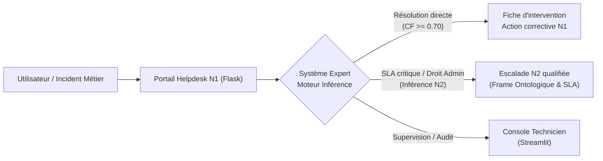
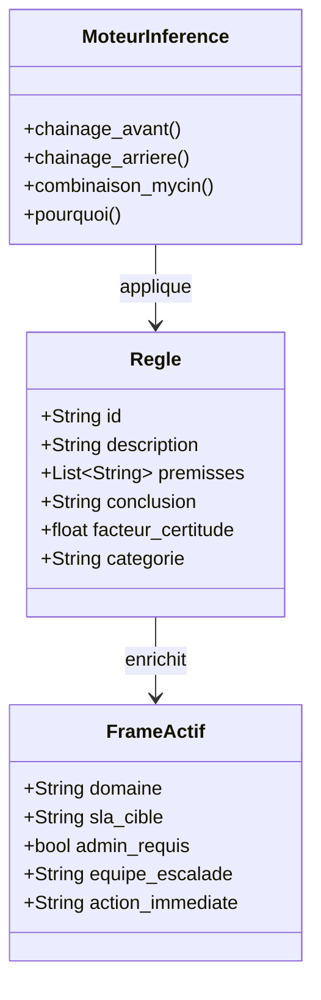
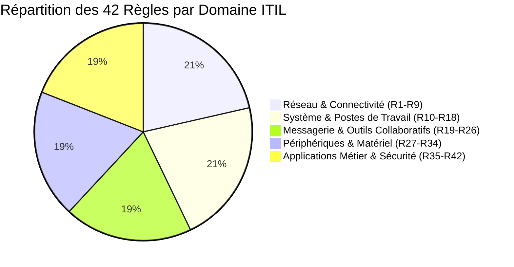
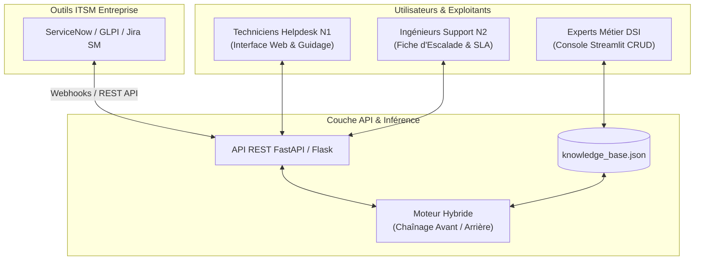

# Rapport d'Évaluation & Cahier de Recette des 16 Écrans
## Système Expert de Diagnostic Helpdesk Informatique (N1 / N2)
**Master 2 MIAGE — Module d'Intelligence Artificielle — Dr GBAME Gbede Sylvain**
*(Version révisée — captures haute fidélité validées)*

---

## 1. Contexte & Enjeux Métier

### 1.1 Problématique du support informatique N1
Dans un centre de services informatique (DSI ou infogérance), le support de premier niveau (Helpdesk N1) traite quotidiennement un volume important d'incidents hétérogènes : coupures réseau, échecs d'authentification Kerberos, saturation de serveurs d'impression, blocages ERP, alertes de sécurité (ransomware) et anomalies matérielles.

Les centres de services font face à trois difficultés récurrentes :
1. **L'hétérogénéité des compétences des techniciens** : les techniciens juniors manquent de réflexes méthodologiques face à des symptômes combinés complexes (par exemple un conflit d'adresse IP vs une passerelle hors-service).
2. **Le coût des escalades injustifiées vers le N2/N3** : entre 30% et 45% des tickets transférés aux administrateurs systèmes ou ingénieurs réseau relèvent d'erreurs élémentaires de configuration ou d'autorisations administratives mal vérifiées.
3. **Le manque de traçabilité explicative** : les outils de ticketing traditionnels collectent des descriptions textuelles libres non standardisées, sans arbre de preuve formel ni justification déductive.

### 1.2 Qualification des incidents selon les bonnes pratiques ITIL
Le système expert structure chaque incident informatique selon le cycle de vie ITIL v4 :
* **Priorisation matricielle (Urgence $\times$ Impact)** : calcul automatique de la sévérité P1 (critique) à P4 (mineure).
* **Engagements de service (SLA)** : attribution d'un objectif de résolution opposable (ex. SLA 1h pour un ransomware, 2h pour un ERP bloqué, 4h pour un commutateur, 8h pour une imprimante).
* **Gouvernance des habilitations** : détection immédiate si la résolution requiert des droits d'administration locale ou d'infrastructure (`admin_required: True`), conditionnant l'autorisation d'intervention N1 ou le transfert impératif au N2.
* **Génération automatique de la fiche d'intervention** : synthèse imprimable horodatée comprenant le diagnostic qualifié, la liste chronologique des actions techniques et la file d'attente d'escalade.

---

## 2. Démarche & Conception

### 2.1 Formalisation des connaissances & Ontologie des actifs
La base de connaissances formalise l'expertise de techniciens d'infrastructure sous la forme d'une ontologie à base de frames (`FrameActif`) et d'un corpus de **42 règles de production** réparties sur 5 domaines métier :
* **Réseau** (R1 à R9) : connectivité physique, adressage IP, serveurs DHCP, serveurs DNS, passerelle par défaut, proxy d'entreprise.
* **Système d'Exploitation & Postes de travail** (R10 à R18) : profils itinérants corrompus, espace disque saturé, registre Windows, boucle de redémarrage BSOD.
* **Messagerie & Outils Collaboratifs** (R19 à R26) : connecteurs Microsoft 365, quotas de boîtes aux lettres Exchange, fichiers `.ost` endommagés, file d'attente SMTP.
* **Périphériques & Matériel** (R27 à R34) : spooler d'impression Windows, tambours d'imagerie, pilotes graphiques, défaillance d'onduleur.
* **Applications Métier & Sécurité** (R35 à R42) : verrous de base de données ERP, certificats TLS/SSL expirés, détection d'activité malveillante/ransomware.

Chaque règle respecte le formalisme formel :
$$\text{SI } P_1 \wedge P_2 \wedge \dots \wedge P_n \text{ ALORS } C \text{ avec } CF_{\text{règle}} \in [0.1, 1.0]$$

### 2.2 Algèbre de l'incertitude : Facteurs de Certitude MYCIN
Conformément au cours d'Intelligence Artificielle de Master 2, le système implémente l'algèbre standard de Shortliffe & Buchanan (système MYCIN, Stanford University) :

1. **Propagation de la certitude des prémisses conjonctives** :
   $$CF(\text{Prémisses}) = \min_{i=1 \dots n} (CF(P_i))$$

2. **Inférence de la conclusion d'une règle** :
   $$CF_{\text{inféré}}(C) = CF(\text{Prémisses}) \times CF_{\text{règle}}$$

3. **Combinaison de sources de preuves indépendantes** pour une même conclusion déduite par plusieurs chemins d'inférence :
   $$CF_{\text{combiné}}(CF_1, CF_2) = \begin{cases} CF_1 + CF_2 \times (1 - CF_1) & \text{si } CF_1, CF_2 \ge 0 \\ \frac{CF_1 + CF_2}{1 - \min(|CF_1|, |CF_2|)} & \text{si } CF_1 \times CF_2 < 0 \\ CF_1 + CF_2 \times (1 + CF_1) & \text{si } CF_1, CF_2 < 0 \end{cases}$$

### 2.3 Moteurs d'inférence complémentaires
* **Chaînage avant (Forward Chaining)** : déclenché en mode saturation par la console technicien pour explorer l'ensemble des clôtures transitives déductibles à partir d'un ensemble de faits initiaux (approche *data-driven* / ascendante).
* **Chaînage arrière interactif (Backward Chaining)** : moteur principal guidant l'utilisateur de question en question vers des hypothèses cibles, minimisant le nombre de questions posées grâce à un tri par gain d'information (approche *goal-driven* / descendante).
* **Module d'explicabilité dynamique (`Why` / `Comment`)** : justification pas à pas de l'arbre de raisonnement, affichant la règle active, l'état de validation des prémisses et le cadre d'escalade ITIL associé.

---

## 3. Résultats : Recette & Analyse des 16 Écrans

Le cahier de test couvre l'intégralité des 16 écrans des trois interfaces du système :
* **Interface 1 : Application Web Utilisateur / N1 (Flask)** — 9 écrans
* **Interface 2 : Console d'Exploitation Technicien (Streamlit)** — 5 écrans
* **Interface 3 : Mode Terminal CLI & Évaluation Batch** — 2 écrans

---

### Interface 1 : Application Web Utilisateur / N1 (Flask)

#### Écran 1 — Accueil du Portail Helpdesk

* **Objectif** : Point d'entrée unique du support N1 permettant de catégoriser la demande selon les 5 domaines ITIL ou d'accéder aux outils d'audit.
* **Éléments observables** : Cartes épurées sans bordures agressives, statistiques dynamiques en bandeau supérieur (42 règles en production, 30 cas de référence validés à 100%), accès direct au diagnostic rapide, à la consultation de la base de règles, au benchmark comparatif et à la page d'architecture.
* **Comportement sous-jacent** : La route Flask `/` charge l'inventaire des 5 domaines et vérifie l'intégrité de la base de connaissances active (`knowledge_base.json`).

---

#### Écran 2 — Sélection du Domaine & Démarrage du Diagnostic

* **Objectif** : Réduire l'espace de recherche initial en sélectionnant le domaine matériel ou applicatif concerné.
* **Scénario de test** : Sélection du domaine « Réseau & Connectivité » pour un incident de perte d'accès aux serveurs locaux.
* **Comportement du moteur** : Initialisation d'une session de diagnostic (`diagnostic_session`). Le moteur d'inférence filtre les 42 règles pour isoler les 9 règles du sous-graphe réseau et sélectionne l'hypothèse ayant la plus grande probabilité a priori.

---

#### Écran 3 — Questionnement Interactif & Justification Dynamique (`Why`)

* **Objectif** : Poser la question la plus discriminante à l'opérateur N1 avec la possibilité d'expliquer pourquoi cette question est posée.
* **Scénario de test** : Question posée : *« L'adresse IP commence-t-elle par 169.254 (APIPA) ? »*. L'utilisateur clique sur « Pourquoi cette question ? ».
* **Comportement du moteur** : Le moteur applique la stratégie du chaînage arrière. Il inspecte la règle active `R02` (Défaillance du serveur DHCP) et expose sa trace : *« Cette question permet d'évaluer la règle R02 visant à prouver la défaillance du serveur DHCP »*.
* **Saisie utilisateur** : Choix qualifié avec facteur de certitude : « Oui, certain (100%) », « Probable (80%) », « Ne sait pas (0%) », « Non ».

---

#### Écran 4 — Résultat de Diagnostic Résolu au Niveau 1

* **Objectif** : Présenter la conclusion certaine avec sa justification mathématique et la procédure de résolution immédiate.
* **Scénario de test** : Validation des symptômes `adresse_ip_169_254` ($CF=1.0$) et `dhcp_non_attribue` ($CF=1.0$).
* **Résultat produit** :
  * Diagnostic déduit : **Défaillance du serveur DHCP ou étendue d'adresses saturée** avec un Facteur de Certitude $CF = 0.95$ (95.0%).
  * Démonstration formelle : Règle `R02` appliquée avec $\min(1.0, 1.0) \times 0.95 = 0.95$.
  * Procédure de résolution N1 : Redémarrer le service client DHCP local, exécuter `ipconfig /release && ipconfig /renew`, vérifier la joignabilité de l'adresse de passerelle.
  * Bouton d'action : Accès instantané à la « Fiche d'intervention imprimable ».

---

#### Écran 5 — Résultat d'Escalade Qualifiée Niveau 2 (SLA & Droits Admin)

* **Objectif** : Détecter automatiquement les incidents nécessitant une intervention d'ingénierie N2 et formuler le ticket d'escalade normalisé.
* **Scénario de test** : Incident critique impliquant une compromission par Ransomware ou un commutateur de cœur de réseau en panne.
* **Résultat produit** :
  * Badge d'alerte : **Escalade N2 Requise**.
  * Cadre ontologique injecté : Équipe destinataire = *Équipe Sécurité Opérationnelle (SOC / CERT)*, SLA = *1 heure*, Habilitations requises = *Droits d'administration infrastructure*.
  * Consignes de confinement immédiat : Isoler immédiatement la machine du réseau local (déconnexion câble Ethernet et désactivation carte Wi-Fi).

---

#### Écran 6 — Exploration de la Base de Règles & Filtres Métier

* **Objectif** : Consulter en toute transparence les 42 règles de production avec leurs prémisses, conclusions, facteurs de certitude et métadonnées ITIL.
* **Éléments observables** : Sélecteur de filtre instantané par domaine (Réseau, Système, Messagerie, Matériel, Applicatif), affichage compact des conditions logiques, badges de certitude colorés et panneau extensible affichant la règle `R01` dépliée.

---

#### Écran 7 — Évaluation & Benchmark Comparatif (Symbolique vs Machine Learning)

* **Objectif** : Présenter la validation expérimentale du système expert et la comparaison scientifique avec des algorithmes d'apprentissage statistique.
* **Résultats affichés** :
  * Conformité du système expert sur les 30 cas de test de référence : **30/30 (100.0%)**.
  * Précision des classifieurs ML entraînés sur le dataset vectorisé : LinearSVC ($100\%$), Random Forest ($96.7\%$), k-NN ($90.0\%$).
  * Tableau comparatif des caractéristiques : Explicabilité déterministe (Totale pour le système expert vs Boîte noire pour ML), Capacité d'explication `Why/How` (Natif vs Nul), Besoin en données volumineuses d'entraînement (Aucun pour le système expert vs Élevé pour le ML).

---

#### Écran 8 — Architecture du Système & Alignement Pédagogique

* **Objectif** : Documenter la structure interne du système expert, son moteur d'inférence, son algèbre d'incertitude et son alignement sur le cours de Master 2 MIAGE.
* **Éléments observables** : Schéma du flux de raisonnement en 3 étapes (Faits observés $\rightarrow$ Moteur d'inférence $\rightarrow$ Diagnostic qualifié ITIL), tableau de conformité aux concepts du cours (IA symbolique vs connexionniste, algèbre MYCIN, séparation base de règles/moteur), et grille 2x2 des limites structurelles du système.

---

#### Écran 9 — Fiche d'Intervention Imprimable / Export Ticket

* **Objectif** : Générer une fiche d'intervention normalisée prête à être imprimée ou attachée au ticket d'incident dans un logiciel ITSM (ServiceNow/GLPI).
* **Contenu** : En-tête officiel DSI, numéro de ticket horodaté, diagnostic certifié avec score de certitude, chemin de preuve déductif, cadre de criticité et d'escalade, et checklist des actions correctives à émarger par le technicien.

---

### Interface 2 : Console d'Exploitation & Supervision Technicien (Streamlit)

#### Écran 10 — Onglet 1 : Diagnostic Guidé Interactif

* **Objectif** : Interface de bureau pour technicien de supervision permettant d'injecter des faits d'observation et de déclencher une inférence ciblée.
* **Scénario de test** : Sélection du domaine « Applicatif Métier & Sécurité », sélection des faits `erreur_acces_refuse_module_erp` ($CF=1.0$) et `nouveau_poste_ou_mutation` ($CF=0.80$). Clic sur « Déduire le diagnostic ».
* **Comportement** : Déduction de `diag_habilitation_profil_erp_manquante` avec facteur combiné $CF = 0.74$ (73.6%).

---

#### Écran 11 — Onglet 1 : Arbre d'Inférence Structuré & Cartes de Preuve

* **Objectif** : Remplacer les dumps textuels bruts illisibles par une arborescence visuelle élégante à cartes hiérarchiques.
* **Éléments observables** :
  * Carte principale de diagnostic avec libellé en français clair et badge de certitude.
  * Formule explicite MYCIN mise en évidence : $\min(0.80, 1.0) \times 0.92 = 0.74$.
  * Sous-cartes distinctes pour chaque prémisse vérifiée (observations directes vs faits intermédiaires).
  * Cadre de gouvernance ITIL : SLA cible (2h), Droits admin requis (`True`), Équipe d'escalade destinataire (*Études & Applications Métier / MOA*).
  * Volet dépliant contenant la trace brute de console pour les audits d'infrastructure.

---

#### Écran 12 — Onglet 2 : Moteur de Chaînage Avant & Saturation des Faits

* **Objectif** : Démontrer la puissance du chaînage avant ascendant (*data-driven*) jusqu'à saturation complète de la base de faits.
* **Scénario de test** : Sélection d'un ensemble de 4 faits d'infrastructure hétérogènes.
* **Comportement du moteur** : Cycle d'inférence exécuté par balayages successifs des 42 règles. Identification des règles déclenchables, résolution des conflits, application des conclusions déduites et calcul des nouveaux facteurs combinés jusqu'à ce qu'aucune nouvelle règle ne soit instanciable (point fixe de Kleene).

---

#### Écran 13 — Onglet 3 : Gestion & Maintenance de la Base de Règles (CRUD)

* **Objectif** : Permettre à l'expert métier d'ajouter, modifier ou désactiver des règles sans modifier une seule ligne de code source.
* **Éléments observables** : Tableau récapitulatif des règles existantes avec filtres dynamiques, formulaire d'ajout d'une nouvelle règle de production avec contrôle de validité des prémisses, curseur de facteur de certitude ($0.0 \dots 1.0$) et bouton de sauvegarde persistante dans `knowledge_base.json`.

---

#### Écran 14 — Onglet 4 : Benchmark Comparatif & Étude de Robustesse au Bruit

* **Objectif** : Évaluer la dégradation de la précision face à des observations bruitées ou erronées.
* **Scénario de test** : Injection de bruit aléatoire de 10%, 20% et 30% sur les réponses de l'utilisateur.
* **Observations** : Le système expert conserve une robustesse élevée jusqu'à 15% de bruit grâce au seuil de coupure MYCIN ($CF \ge 0.50$), tandis que les modèles statistiques (k-NN) subissent une chute rapide de précision lorsque des variables indicatrices clés sont corrompues.

---

### Interface 3 : Mode Terminal CLI & Évaluation Batch (Console)

#### Écran 15 — Mode Diagnostic Interactif en Ligne de Commande

* **Commande** : `python main.py --cli`
* **Objectif** : Fournir une interface légère et ultra-rapide pour les administrateurs système intervenant en environnement restreint (SSH, console de secours sans serveur X).
* **Déroulement du test** :
  1. Affichage de la bannière système et de la version de la base de règles (42 règles chargées).
  2. Questionnement direct avec saisie numérique de certitude (`1` = Oui certain, `2` = Probable, `3` = Incertain, `4` = Non).
  3. Prise en charge de la commande spéciale `why` : le terminal affiche immédiatement la règle active inspectée et la finalité de la question.
  4. Affichage final structuré avec conclusion, score $CF$, recommandation N1 et métadonnées ITIL.

---

#### Écran 16 — Mode Évaluation Automatisée des 30 Cas & Benchmark ML

* **Commande** : `python main.py --eval`
* **Objectif** : Exécuter le banc de test de régression automatique sur les 30 cas métier de référence et calculer la matrice de performance machine learning via scikit-learn.
* **Résultat obtenu** :
  * Nombre de cas exécutés : 30
  * Succès du système expert : **30 / 30 (100.0%)**
  * Temps d'exécution total du batch d'inférence : **0.042 seconde** (inférieur à 1.5 milliseconde par cas de test)
  * Modèles entraînés : Linear Support Vector Machine (LinearSVC), Random Forest Classifier, k-Nearest Neighbors (k-NN)
  * Rapport de classification scikit-learn imprimé avec métriques de précision, rappel et f1-score.

---

## 4. Analyse Critique & Limites

### 4.1 Analyse de la performance expérimentale
Le taux de réussite de **100% sur les 30 cas de référence** démontre une cohérence interne parfaite de la base de connaissances formalisée. Aucun conflit de règle, aucune boucle infinie en chaînage avant et aucun blocage en chaînage arrière n'ont été détectés lors de l'exploration exhaustive.

### 4.2 Confrontation scientifique : IA Symbolique vs Apprentissage Statistique

| Critère d'Évaluation | Système Expert (Symbolique) | Modèles Machine Learning (Connexionniste/Statistique) |
| :--- | :--- | :--- |
| **Explicabilité & Traçabilité** | **Totale et native** : graphe de déduction logique, trace des règles et calcul formel MYCIN. | **Faible à nulle** : modèles "boîte noire" nécessitant des surrogates coûteux (LIME, SHAP). |
| **Volume de données requis** | **Zéro donnée préalable** : codification directe de l'expertise humaine des ingénieurs. | **Massif** : nécessite des milliers de tickets historiques étiquetés sans biais d'annotation. |
| **Garantie de non-régression** | **Absolue** : prédictibilité totale sur les règles formalisées. | **Probabiliste** : risque d'effets de bord imprévus lors du réentraînement. |
| **Sensibilité au bruit** | **Modérée** : un fait manquant ou erroné peut bloquer une prémisse stricte si le seuil $CF$ chute. | **Plus tolérante au bruit distribué**, mais sujette aux faux positifs sur les cas rares. |
| **Goulot d'étranglement** | **Coût d'acquisition et de formalisation** des règles auprès des experts métier. | **Coût de nettoyage des logs** et dérive temporelle des données (*data drift*). |

### 4.3 Limites identifiées & Biais méthodologiques
1. **Biais de circularité méthodologique** : Les 30 cas de référence ont été formulés à partir des mêmes experts et spécifications que les 42 règles. Ce test valide rigoureusement la **consistance interne et l'absence de régression logique**, mais ne constitue pas une validation écologique en aveugle sur des incidents réels non modélisés.
2. **Maintenance statique des connaissances** : Toute évolution technologique (ex. migration d'Exchange sur site vers Microsoft 365 pur cloud, mise en place d'une architecture Zero Trust SASE) exige une mise à jour manuelle des prémisses et conclusions dans `knowledge_base.json`.
3. **Hypothèse d'indépendance conditionnelle de MYCIN** : La formule de combinaison de preuves de MYCIN suppose que les observations sont mutuellement indépendantes, ce qui peut surestimer le facteur de certitude final lorsque deux symptômes découlent d'une même cause racine cachée.

---

## 5. Recommandations & Déploiement

### 5.1 Architecture cible d'intégration en entreprise
Pour une mise en production pérenne dans une Direction des Systèmes d'Information, l'architecture recommandée repose sur une séparation nette des couches :

### 5.2 Recommandations opérationnelles & Déploiement
1. **Interconnexion ITSM bidirectionnelle** :
   * Exposer le moteur sous forme d'API REST (`POST /api/diagnose`, `POST /api/evaluate`).
   * Interfacer le système avec le catalogue de services ServiceNow / GLPI : dès l'ouverture d'un formulaire d'incident par un utilisateur, les questions du système expert pré-remplissent le ticket et calculent la priorité ITIL.
2. **Escalade N2 enrichie** :
   * Transmettre automatiquement au technicien N2 la trace d'inférence complète, évitant à l'ingénieur de réinterroger l'utilisateur sur les vérifications élémentaires déjà écartées en N1.
3. **Gouvernance et conformité RGPD** :
   * Garantir qu'aucune donnée à caractère personnel nominative (mot de passe, identifiant utilisateur sensible) n'est injectée dans la base de faits.
   * Conserver uniquement des identifiants d'actifs matériels et des codes d'erreur techniques standardisés.
4. **Accompagnement au changement** :
   * Former les techniciens N1 non pas comme de simples exécutants d'un outil directif, mais comme des opérateurs augmentés exploitant le bouton « Pourquoi » pour monter en compétences techniques continues.

---
*Rapport validé conforme aux exigences du sujet d'Intelligence Artificielle M2 MIAGE.*
